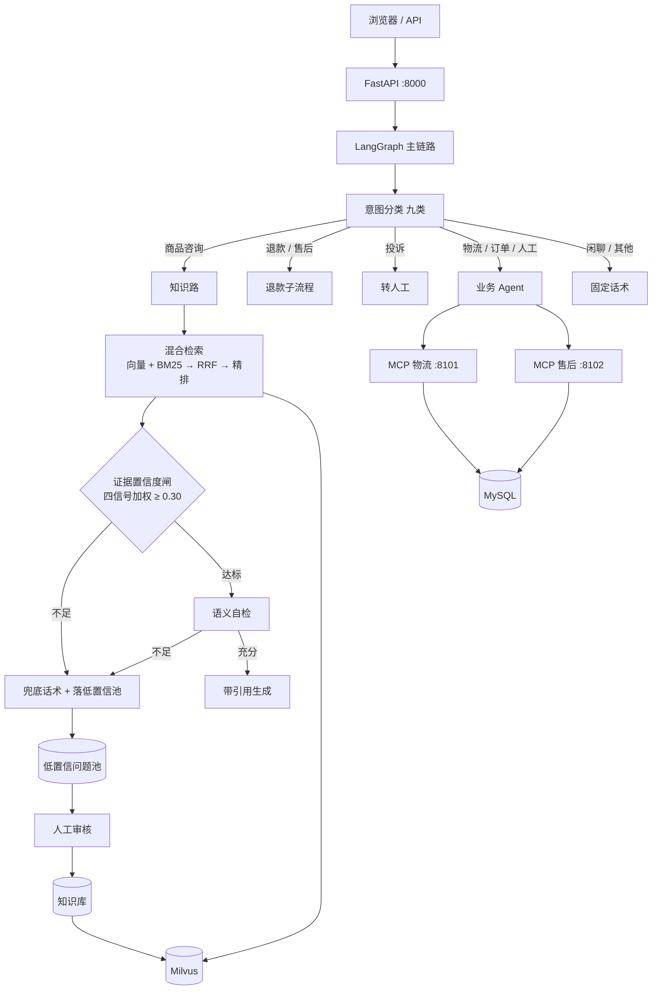

# Pxx — 电商售后智能客服 Agent

面向电商售后场景的智能客服系统：能查订单与物流、回答退换货政策、走退款/工单流程，
并在证据不足时**主动拒答转人工**，同时把答不上的问题沉淀成知识缺口，供人工补齐。

核心不是「接个大模型聊天」，而是解决两个工程问题：**检索要准**、**生成不许编**。

---

## 功能一览

| 能力 | 说明 |
|---|---|
| 混合检索问答 | 向量召回 + BM25 关键词召回，RRF 名次融合，BGE-Reranker 精排 |
| 九类意图分流 | 物流 / 订单 / 商品咨询 / 退款退货 / 售后 / 投诉 / 人工 / 闲聊 / 其他 → 五个出口 |
| Workflow + Agent | 必经步骤（分流、检索、证据校验）写进图；Agent 只负责证据齐备后的工具组合与措辞 |
| 幻觉治理 | 四信号加权置信度闸 + 生成前语义自检，不达标直接兜底 |
| 工具调用 | 订单、物流、FAQ、商品、建单、退款，经 MCP 暴露为独立进程 |
| 长对话上下文 | 摘要层 / 半压层 / 原文滑窗三层管理，按 token 预算切窗 |
| 数据飞轮 | 三个入口（检索低分 / 自检不足 / 用户差评）落池，人工审核后回写知识库 |
| 可观测 | Langfuse trace 按意图打标，拒答率、工具调用、成本可查 |
| 主题分类器 | RoBERTa 多标签微调 + 阈值扫描 + ONNX 轻量部署（旁路） |

---

## 架构



**一次知识类问答的链路**：意图 → 检索（双路召回 50 → 融合 → 精排 10）→ 四信号打分 →
低于阈值则兜底落池，否则语义自检 → 带引用编号生成 → 返回答案与引用。

---

## 演示

完整的三段真实调用记录（含请求、响应、工具调用参数）见 **[docs/DEMO.md](docs/DEMO.md)**。

### 1. 查物流：工具调用链

```bash
curl -s http://localhost:8000/api/agent \
  -H 'Content-Type: application/json' \
  -d '{"user_id":"u1","message":"订单 1001 的物流到哪了"}'
```

返回（节选，真实响应）：

```json
{
  "answer": "亲，帮您查到订单 1001（智能猫砂盆）的物流情况啦～\n- 物流单号：SF213502378238\n- 当前状态：已揽件\n- 当前位置：成都\n- 最新轨迹：成都分拨中心 已发出",
  "tool_calls": [
    {"name": "query_order", "args": {"order_id": "1001"}},
    {"name": "query_logistics", "args": {"tracking_no": "SF213502378238"}}
  ]
}
```

### 2. 政策问答：带引用

问「退货政策是什么样的」，回答里每个结论后带 `[1][5][7]` 这类编号，对应检索到的知识块。

### 3. 库外问题：如实拒答

问知识库里没有的内容时，系统不会编造，而是回兜底话术、给出转人工入口，
并把原问题与召回快照写进低置信池。

---

## 快速开始

### 前置

| 项 | 要求 | 检查 |
|---|---|---|
| Docker | Docker Desktop（Windows 需开启 WSL Integration） | `docker compose version` |
| uv | Python 包管理 | `uv --version` |
| make | 构建入口 | `make --version` |
| 内存 / 磁盘 | 8 GB / 10 GB 起 | — |

> Windows 建议在 **WSL2 Ubuntu** 里跑，并把源码放在 WSL 自己的文件系统（如 `~/pxx`），
> 不要放 `/mnt/c`，否则 bind mount 与 I/O 会明显变慢。Ubuntu 内需要 `apt install build-essential`。

### 1. 装依赖

```bash
uv sync -p 3.12
```

> 必须指定 3.12：项目依赖的 `asyncmy` 在 Python 3.14 上源码编译会失败。
> 国内网络慢可加镜像：`UV_DEFAULT_INDEX=https://pypi.tuna.tsinghua.edu.cn/simple uv sync -p 3.12`

### 2. 配置密钥

```bash
cp .env.example .env
```

填三个值（嵌入与重排同一家时可填同一个 key）：

```dotenv
CHAT_BASE_URL=https://api.deepseek.com/v1
CHAT_MODEL=deepseek-v4-flash
CHAT_API_KEY=sk-xxx          # 聊天上游

EMBED_API_KEY=sk-xxx         # 硅基流动 bge-m3
RERANK_API_KEY=sk-xxx        # 硅基流动 bge-reranker-v2-m3
```

> `.env` 已被 `.gitignore` 排除，不要把真实密钥提交进仓库。

### 3. 起依赖容器

```bash
docker compose up -d
```

拉起 MySQL、Milvus、MinIO、etcd。建表脚本在 `sql/`，MySQL 首次启动会按文件名顺序自动执行。

```bash
docker compose ps     # 四个容器都应为 healthy
```

### 4. 灌测试数据

```bash
make seed        # FAQ
make seed-conv   # 历史会话
```

### 5. 建知识库

```bash
make kb-build       # 切块落 MySQL
make kb-vectorize   # 向量化写 Milvus（会调用嵌入接口）
```

### 6. 启动

```bash
make dev
```

会等 Milvus 就绪，拉起两台 MCP Server（:8101 / :8102），最后启动应用（:8000）。
这是**前台常驻进程**，Ctrl+C 停止；后台跑时用 `make dev-down` 收尾。

### 7. 验收

```bash
curl -s http://localhost:8000/ -o /dev/null -w "%{http_code}\n"      # 期望 200

curl -s http://localhost:8000/api/agent \
  -H 'Content-Type: application/json' \
  -d '{"user_id":"u1","message":"订单 1001 的物流到哪了"}'
```

期望响应里 `tool_calls` 同时包含 `query_order` 与 `query_logistics`。

浏览器打开 <http://localhost:8000> 即为聊天页。

---

## 端口与页面

| 端口 | 用途 |
|---|---|
| 8000 | 应用（聊天页 `/`） |
| 8101 / 8102 | MCP Server：物流 / 售后 |
| 19530 / 9091 | Milvus / 健康检查 |
| 8110 | 主题分类器（`make classifier-up` 后） |
| 3000 | Langfuse（`make langfuse-up` 后） |

其他页面：`/kb` 知识库录入、`/review` 飞轮待审、`/observability` 观测与成本、
`/topics` 主题分布、`/acceptance` 分类器验收。

---

## 目录结构

| 路径 | 内容 |
|---|---|
| `app/api/` | HTTP 入口：聊天、Agent、知识库、复核、验收、成本看板 |
| `app/graph/` | LangGraph：`state` / `nodes` / `routing` / `build` |
| `app/core/` | 检索、重排、意图、指代、摘要、置信度、飞轮、可观测 |
| `app/kb/` | 切块、嵌入、MySQL + Milvus 双写、去重 |
| `app/tools/` | 内置 `@tool`、MCP 客户端、注册表、执行引擎 |
| `app/db/` | 表模型与仓储 |
| `app/static/` | 前端页面 |
| `mcp_servers/` | 物流 / 售后两台独立 MCP Server |
| `sql/` | 建表与种子数据 |
| `scripts/` | 建库、评估、校准、微调等离线任务 |
| `docs/` | 设计与实现文档、演示记录 |

---

## 常用命令

```bash
make test              # 单元测试（不调用真实模型）
make kb-build          # 重建知识块
make kb-vectorize      # 向量化
make calibrate-confidence   # 置信度阈值校准（需 Milvus + 上游可用）
make eval-rag          # 四策略检索评估
make dev-down          # 停止应用与 MCP Server
docker compose stop    # 停止容器（数据保留在 volume）
```

`make help` 可看完整目标清单。

---

## 评估口径

| 指标 | 数值 | 口径 |
|---|---|---|
| Recall@5 | 98% | 自建 300 题五桶评估集，240 道可答题，Top-5 命中任一标注块 |
| MRR | 89.4% | 首个正确结果倒数名次的平均，分母 240 |
| 置信度阈值 | 0.30 | 可答通过率 82.9%，应拒放行率 0% |
| 幻觉率 | 0.7% | LLM-as-judge 初筛 + 人工逐条复核 |

以上均为**评估集口径**，不代表线上 SLA。阈值不是拍的：在 240 可答 / 60 应拒上扫描，
Youden J 最优点是 0.17（通过 94.2% / 放行 5%），最终取 0.30 是业务取舍——
误放会引发售后纠纷，误拦只是多转一次人工，且被拦问题会进飞轮回收。

---

## 常见问题

**MySQL 起不来，报 3306 端口被占**
本机已有 MySQL 在跑。停掉它，或改 `docker-compose.yml` 的端口映射并同步修改 `.env` 的
`DATABASE_URL`。不要直接删容器了事。

**`uv sync` 卡住或很慢**
WSL 默认不走 Windows 代理；用国内镜像（见步骤 1），或给 WSL 配代理。

**`asyncmy` 编译失败**
Python 版本过新（3.14）。用 `uv sync -p 3.12`。

**Milvus 一直 unhealthy**
先看 `docker compose logs milvus`；首次启动需要几十秒，超过两分钟再排查内存与磁盘。

**镜像拉不下来**
Docker Hub / quay.io 国内常连不上，可走镜像站拉取后 `docker tag` 回原名，`docker-compose.yml` 不用改。

---
